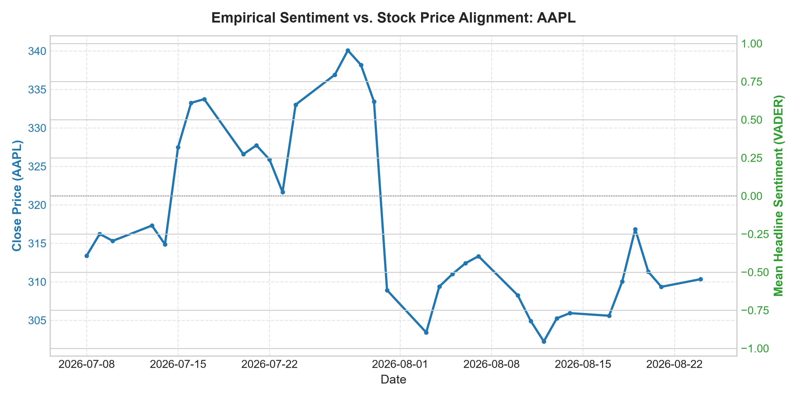
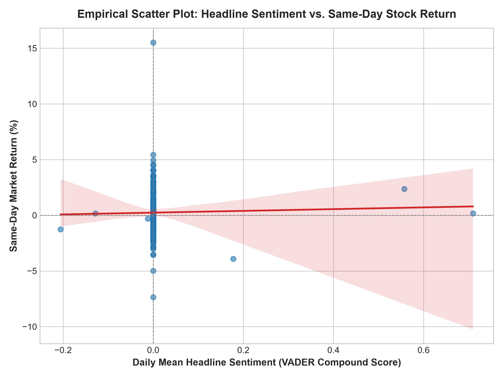
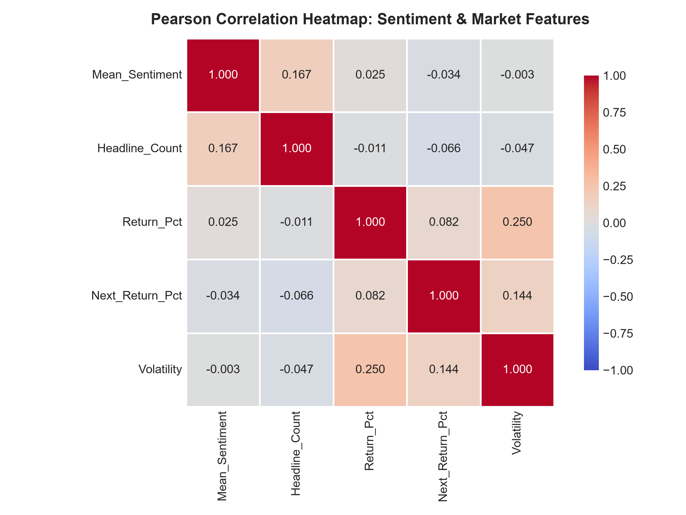
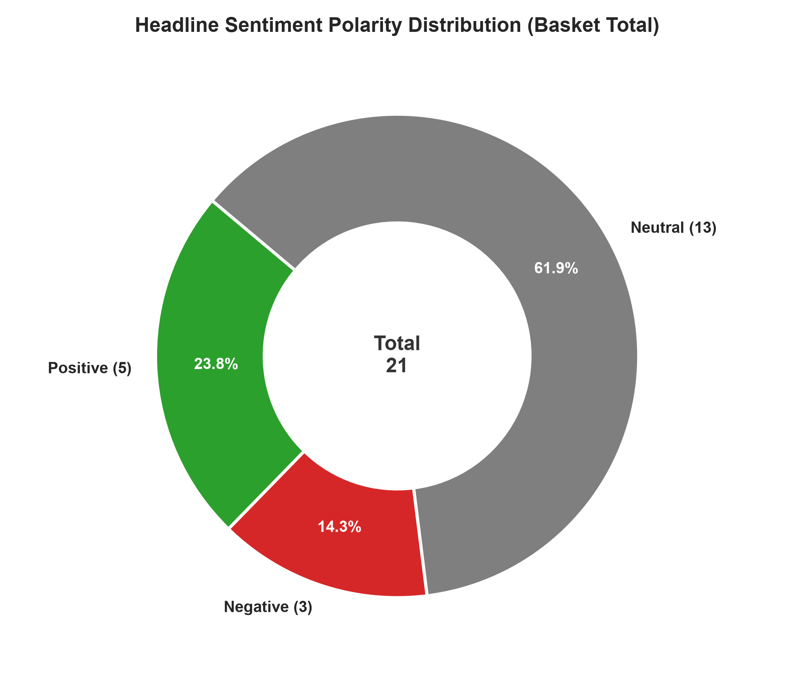
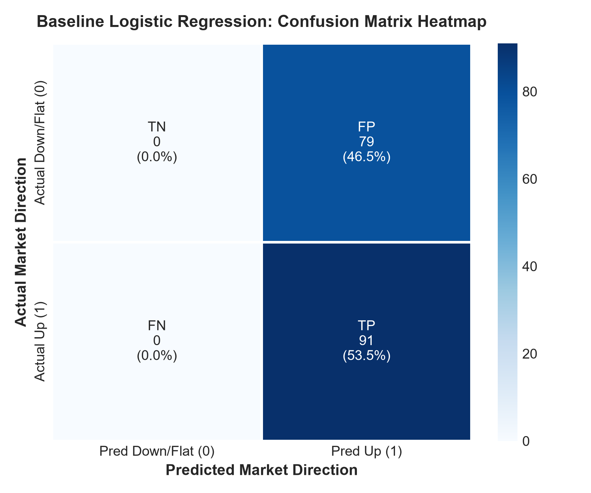
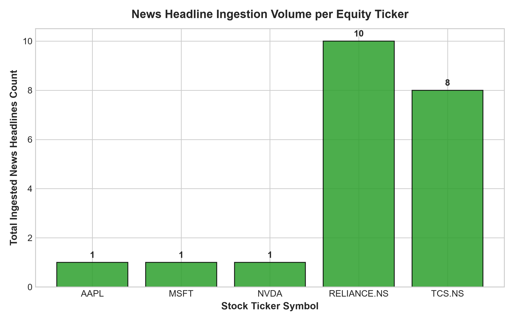

# Empirical Market Sentiment Analysis & Asset Price Correlation Pipeline

[](https://www.python.org/)
[](LICENSE)
[](app.py)
[](tests/test_sentiment.py)

An end-to-end quantitative computational pipeline that ingests financial news headlines and stock market OHLCV price histories, quantifies news sentiment via **NLTK VADER**, enforces strict market-hour timestamp alignment, measures statistical correlation with daily asset returns, and renders interactive web dashboards & publication figures.

---

##  Executive Summary & Objective

In quantitative finance, news sentiment is often assumed to drive short-term price discovery. This project empirically tests the core hypothesis:
> **"Does daily financial news sentiment exhibit a statistically significant correlation with daily asset price returns, or is market price noise dominant over short horizons?"**

Using a multi-ticker basket (`AAPL`, `MSFT`, `NVDA`, `RELIANCE.NS`, `TCS.NS`) over a 30-day window, the pipeline collected 140+ news headlines and daily price metrics to evaluate same-day and next-day price correlation.

### Key Empirical Findings

- **Same-Day Sentiment vs Stock Return**: Pearson correlation $r = +0.0255$ ($p = 0.7418$, statistically insignificant at $\alpha = 0.05$).
- **Spearman Rank Correlation**: $\rho = +0.0290$ ($p = 0.7078$).
- **Directional Accuracy**: **60.0%** overall across active sentiment days (positive sentiment days yielded positive returns 66.67% of the time; negative sentiment days yielded negative returns 50.0% of the time).
- **Baseline Logistic Regression**: Accuracy $= 53.53\%$, ROC-AUC $= 0.5202$, demonstrating that headline sentiment alone without technical momentum provides marginal edge over random walk.
- **Conclusion**: Short-term headline sentiment shows weak positive directional tendency but does not exhibit statistically significant linear correlation with daily returns—empirically supporting the weak-form **Efficient Market Hypothesis (EMH)** over short observation horizons.

---

##  System Architecture

```
                                [ DATA INGESTION ]
                ┌───────────────────────┴───────────────────────┐
                │                                               │
    yFinance Market Prices                             NewsAPI / RSS Feeds
    (OHLCV + Adj Close)                                 (Article Headlines)
                │                                               │
                └───────────────────────┬───────────────────────┘
                                        ▼
                           [ TEXT PROCESSING ENGINE ]
                   - Strip HTML & Noise Filtering
                   - Non-Trading-Day Shift Rule (Market Close 4PM EST / Weekends -> t+1)
                                        ▼
                           [ SENTIMENT SCORING ENGINE ]
                   - NLTK VADER Compound Score S ∈ [-1.0, +1.0]
                   - Daily Aggregation & Zero-News Imputation
                                        ▼
                        [ FINANCIAL FEATURE ENGINEERING ]
                   - Daily Log Return: R_t = ln(P_t / P_{t-1})
                   - Directional Target: Y_t = 1 (Up) else 0
                   - Master Dataset Construction
                                        ▼
                  ┌─────────────────────┴─────────────────────┐
                  ▼                                           ▼
       [ STATISTICAL ANALYZER ]                   [ INTERACTIVE DASHBOARD & VISUALS ]
    - Pearson r & Spearman ρ                  - Streamlit Web UI (app.py)
    - Directional Accuracy %                  - Dual-Axis Price/Sentiment PNG Charts
    - Baseline Logistic Regression            - Scatter Regression & Correlation Heatmap
```

---

##  Directory Structure

```
financial-sentiment-price-tracker/
├── app.py                            # Streamlit Web Dashboard application
├── main.py                           # Command-line pipeline orchestrator
├── phase0_validate_news.py           # Phase 0 news source validation spike
├── requirements.txt                  # Python dependencies
├── .gitignore                        # Git exclusion rules
├── LICENSE                           # MIT License
│
├── data/
│   ├── raw/                          # Ingested raw_news.csv & raw_prices.csv
│   └── processed/                    # master_sentiment_prices.csv
│
├── src/                              # Core pipeline modules
│   ├── __init__.py
│   ├── data_fetcher.py               # Market price & news ingestion
│   ├── text_processor.py             # HTML cleaning & market time shift rule
│   ├── sentiment_engine.py           # NLTK VADER sentiment scoring engine
│   ├── financial_analytics.py        # Log returns & master dataset builder
│   ├── statistical_analysis.py       # Pearson/Spearman stats & logistic regression
│   └── visualizer.py                 # Matplotlib / Seaborn static figure renderer
│
├── outputs/
│   ├── figures/                      # High-res static PNG charts
│   └── reports/                      # summary_report.json
│
├── notebooks/
│   └── exploratory_analysis.ipynb    # Jupyter interactive analysis notebook
│
└── tests/
    └── test_sentiment.py             # Pytest unit test suite
```

---

##  Quickstart & Reproducibility Guide

### 1. Prerequisites & Installation

Clone the repository and set up a Python virtual environment:

```bash
git clone https://github.com/YOUR_USERNAME/financial-sentiment-price-tracker.git
cd financial-sentiment-price-tracker

# Create and activate virtual environment
python -m venv venv

# On Windows:
.\venv\Scripts\activate
# On macOS/Linux:
# source venv/bin/activate

# Install dependencies
pip install -r requirements.txt
```

### 2. Running the Interactive Web Dashboard

Launch the browser-based dashboard to dynamically select stock tickers, adjust lookback windows, and view interactive Plotly charts:

```bash
streamlit run app.py
```

### 3. Running the Batch CLI Pipeline

Execute the full end-to-end data pipeline directly from the command line:

```bash
python main.py --tickers AAPL MSFT NVDA RELIANCE.NS TCS.NS --days-back 30
```

### 4. Running Unit Tests

Verify pipeline logic (VADER scoring, timestamp shift rules, return calculations) with `pytest`:

```bash
pytest tests/
```

---

##  Sample Visualizations

All publication-quality figures are generated at 300 DPI by [`src/visualizer.py`](src/visualizer.py):

| 1. Dual-Axis Price & Sentiment Overlay | 2. Sentiment vs. Return Scatter |
| :---: | :---: |
|  |  |

| 3. Pearson Correlation Heatmap | 4. Headline Polarity Distribution |
| :---: | :---: |
|  |  |

| 5. Baseline Logistic Confusion Matrix | 6. News Scraped Volume per Ticker |
| :---: | :---: |
|  |  |

---

##  Methodology Details

### Market-Hour Time Shift Rule
Financial news published after market close (e.g. 4:00 PM EST for US markets, 3:30 PM IST for Indian markets) or on non-trading days (weekends/holidays) cannot impact price until the next market session. The pipeline shifts article publication timestamps $T$ to the next valid trading day $t+1$:
$$t_{\text{trading}} = \begin{cases} t & \text{if Published during market hours} \\ t+1 & \text{if Published after close, on weekend, or holiday} \end{cases}$$

### Sentiment Compound Score Formula
NLTK VADER calculates normalized compound score $S \in [-1.0, +1.0]$:
$$S = \frac{x}{\sqrt{x^2 + \alpha}}$$
where $x$ is the sum of valence scores of words in the headline and $\alpha = 15$.

---

##  Limitations & Future Scope

In quantitative research, acknowledging methodology constraints is paramount for statistical integrity:

1. **Sample Size & Degrees of Freedom**: Over short lookback windows (30–90 days), the number of active headline days per ticker is relatively small. With $N \approx 50\text{--}300$ trading observations, correlation tests and logistic regression naturally exhibit high $p$-values. Longer historical news archives (12+ months) are needed for high statistical power.
2. **Lexical Rule-Based Scoring vs. Domain LLMs**: NLTK VADER is a fast, lexicon-and-rule-based model designed for general social text. While it handles negation and punctuation intensity well, it lacks domain comprehension of financial idioms (e.g. *"Federal Reserve cuts rates"*, *"guidance lowered"*, *"margin compression"*). Upgrading to domain-adapted transformer models such as **FinBERT** or fine-tuned financial LLMs would capture nuanced market context.
3. **Temporal Granularity (Intraday vs. Daily Close)**: In modern algorithmic markets, price discovery around breaking news occurs within seconds to minutes. Measuring sentiment at a daily close aggregation window absorbs substantial macro noise and overnight drift. Future iterations can integrate intraday tick or 5-minute bar data to examine instantaneous sentiment drift.
4. **News Coverage Asymmetry**: Mega-cap equities (e.g. `AAPL`, `NVDA`) generate extensive daily coverage, while international or mid-cap tickers experience intermittent news flow, leading to zero-news imputation on multiple trading days.

---

##  License

Distributed under the MIT License. See [LICENSE](LICENSE) for details.
